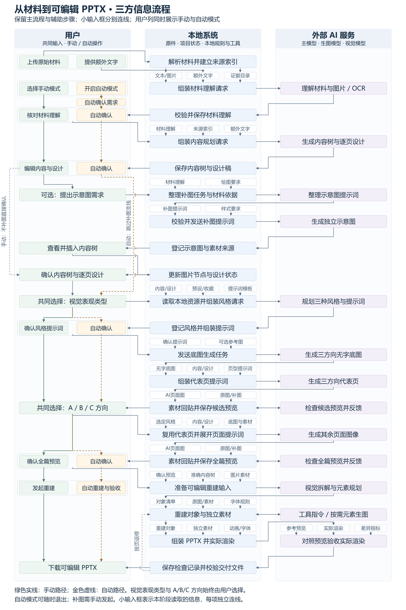
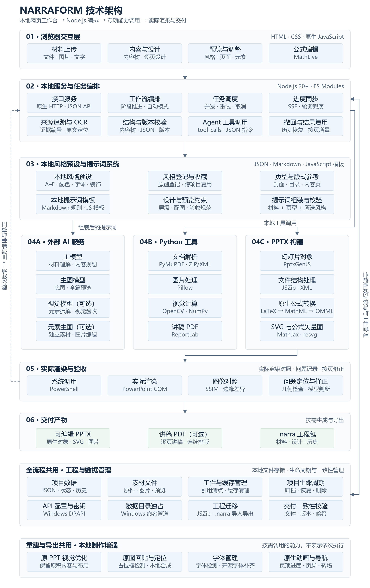

# NARRAFORM

当前版本：**1.0.1**。


把原始材料转成有来源索引、视觉完整、可继续编辑的 PPTX。NARRAFORM 在本地网页中串联材料理解、全篇规划、视觉方案、整页预览与元素重建，使用自行配置的模型 API。

核心方法是 **LLM 理解与登记对象，本地算法按预览测量拟合，PowerPoint 实际渲染验收**。文字、公式、普通图形与线路径以原生对象重建，复杂矢量使用 SVG，照片与现实素材保留图片形式；页面背景使用登记无字底图。

## 主要能力

| 能力 | 可以做什么 |
| --- | --- |
| 多材料理解 | 上传文件、文件夹或粘贴文字，结合制作要求理解各份材料及其关系，保留原文、图片、表格、公式与来源索引 |
| 全篇内容规划 | 按研究汇报、产品介绍、项目答辩、教学、经营汇报或商业路演等任务组织页序，分配材料和配图，限定每页的表达任务与展开范围 |
| 内容与设计编辑 | 编辑多层内容树、表格、公式、图片标题和图注，拖动排序或调整层级；查看来源，修改单页设计稿，生成补充图片 |
| 三种视觉方向 | 选择简约平面或写实／立体表现，确认三种方向的底图与代表页；使用预设、仅借配色或收藏原创风格并跨项目复用 |
| 完整页面预览 | 在对应无字底图上生成页面，本地贴回材料原图，检查图片占位、图文关系和实际成品；支持提示词编辑、图生图修改和跨方向参考 |
| 测量拟合与归并 | 识别对象身份、几何与层级，测量位置、形状、线路径、填充、描边、透明度及文字颜色；按独立置信度归并相近参数 |
| 可编辑交付 | 输出原生文字、Office 公式、可调图形、自定义线路径和局部组合；保留 SVG 与图片素材，通过实际 PowerPoint 渲染逐页对照 |
| 演示与章节 | 统一页顶进度条、可选额外章节页及页脚页码；支持标题平滑切换、进度状态变化与其他内容淡入淡出 |
| 局部迭代 | 按页修改、`@` 指定元素、框选补拆、遗漏文字补全、单页重试和撤回；复用未修改页面与成功素材 |
| 本地工程管理 | 自动保存、任务进度、工程归档与恢复、按引用清缓存、导出与导入 `.narra` 工程包；讲稿 PDF 按需生成 |

## 启动

**环境要求**：Node.js 20+、Python 3.11+。完整的 PPTX 渲染、实测排版和动画验证需要 Windows 与已安装的 Microsoft PowerPoint。

```powershell
git clone https://github.com/fang628/NARRAFORM-pptx-workflow.git NARRAFORM
cd NARRAFORM
.\start.cmd
```

启动脚本会补齐缺少的依赖并运行服务，在浏览器访问 [本地工作台](http://127.0.0.1:4357/)。更新代码后重新运行脚本即可补充新增依赖。也可手动安装与启动：

```powershell
npm.cmd install
python -m venv .venv
.\.venv\Scripts\python.exe -m pip install "pip>=26.3,<27"
.\.venv\Scripts\python.exe -m pip install -r requirements.txt
npm.cmd start
```

自定义端口：`$env:PORT='4359'; npm.cmd start`。通过 `PPT_AGENT_PYTHON` 指定 Python 路径，通过 `PPT_AGENT_DATA` 指定数据目录。Windows 下同一数据目录只允许一个服务实例；需要独立运行时，同时设置不同端口和数据目录。

## API 配置

在网页右上角填写 Base URL、模型名和 API Key，支持自动保存与连接测试。全部项目共用一套配置，修改或清除会对全部项目生效，新建、切换及导入项目均可复用。

| 通道 | 用途 |
| --- | --- |
| 主模型 | 材料理解、内容规划、设计稿、元素拆解、视觉验收及工具修改；需支持图片输入 |
| 生图模型 | 底图、视觉方案、全篇预览；需支持图片生成和参考图编辑 |
| 元素生图模型（选填） | 补充图片及纯色底素材生成，留空沿用生图模型 |

文字接口采用 Chat Completions 兼容协议；生图采用 Images API 的 `generations` / `edits`，不支持异步轮询协议。整页图片要求 16:9，优先 1920×1080；较小同比例图片和微小像素取整按预览契约规范化。

生图及参考图编辑单次请求最多等待 20 分钟，结果图片下载最多等待 3 分钟，文字模型单次请求最多等待 5 分钟。生图超时不自动重新提交可能已计费的请求，等待期间可主动取消任务。

Windows 下密钥使用当前用户 DPAPI 加密保存，重启自动恢复；升级时迁移最近保存的可解密项目配置，其他平台仅存于内存。API 调用及连接测试可能消耗供应商额度。

## 五步使用流程

### 01 需求与材料

支持 TXT、Markdown、CSV、JSON、DOCX、PPTX、PDF、PNG 和 JPEG，支持上传文件夹及粘贴文字。单文件上限 500 MB；目标页数支持 1–30 页，也可留空，由材料理解后建议。封面、目录与致谢计入目标页数，额外章节页不计入。

**上传材料下的补充文字是制作要求**，用于确定目标、重点、排除范围及材料之间的关系，并传递到全篇规划、正文精简和设计；它不作为与上传文件并列的材料或事实证据。材料理解先建立各材料的内容、证据与结构，再围绕制作需求形成整体认识，完整原文和索引保存在本地。

材料处理包括：

- PPT/PDF 逐页分析布局、阅读顺序和叙述逻辑，仅将内容图片提取为材料；页面截图供分析，不作为内容配图。
- PPTX 图片直接读取内嵌原件，保留原始字节；组合图、原生图表按对象独立导出，来源变换单独记录。
- 论文配图结合图片边界、图注编号与局部视觉定位完整范围；组合图在子图标签、说明及分隔结构相互支持时拆分，证据不足保留整图。人工裁片和完整原图始终保留。
- 表格优先读取文件内表头与单元格；扫描表格识别为结构化数据，供内容树按需选用，不直接裁成表格图片。

### 02 逐页内容与设计

先规划全篇页序、每页表达任务、材料来源与配图，再逐页生成多层内容树及设计稿。规划按照实际任务组织常见 PPT 叙事：研究围绕问题、方法和证据，教学按理解依赖推进，产品介绍从对象与用途展开，工作经营与决策汇报侧重结论和行动。

每页保存必含信息与不展开范围，逐页生成接收全篇提纲，减少跨页重复和越界扩写。只将服务本次目标的材料编入页面，不逐文件照搬，也不补造缺少依据的栏目；相关的限制、风险及反向结果正常编排，内部核对事项不上屏。开场明确主题，中间形成层次，结尾回应开头，致谢不替代内容收束。

长材料按页选取证据块，保留相邻条件、完整表格和公式结构，全文与证据索引留在本地。正文精简保留数字、单位、条件及独立分点，不能靠机械截字或缩小字号塞文；明确要求完整保留时按用户要求处理。设计稿集中记录会影响后续构图、图文位置、承载、视觉关系及局部风格的信息。

可编辑内容树、Markdown/LaTeX、表格、图片标题或图注，拖动排序和调整层级，点击来源定位原文，也可生成补充图片。图片仅有一个图片标题或一条图注。公式编辑与保存共用兼容规则，支持 `\tag` / `\tag*`、`\label` 和常用省略号；不支持的命令报告具体原因，原始文案继续保存在工程中。

主题建议、全篇规划和逐页生成共用简洁文案规则：主题直接命名内容，标题不附制作提要，副标题仅在有独立信息时填写；按材料说清对象、条件和结果，减少重复解释与无依据的价值评价。文字只设上限，不按目标区间凑字；原文引用、专名、术语、数据及必要限定保留。规则在生成请求内执行，已确认页面不被自动改写。

点击“保存并确认内容与设计”进入视觉方案。材料、补充文字或全篇要求变化后重新规划；已确认页面不自动改写。仅改文案时可同步已有设计稿。

上传 PPTX 并在补充说明写明“只优化视觉风格、不重做”，可沿用原稿页序、准确文字、框位、表格及图文关系，后续保留原稿布局来优化视觉和重建。

### 03 视觉方案

先选择简约平面或写实／立体表现，再确认三种方向及提示词，生成对应底图与代表页。自动选型仅从主题适配的预设中借用配色，未找到适配预设时生成原创配色。完整采用、仅借配色和原创风格分别记录，登记风格可收藏并跨项目复用。网页本身的工业风不决定 PPT 风格。

底图为后续叠加内容预留空间，封面、目录和内容底图按用途生成；未启用的页型不强制生成底图，额外章节页复用目录底图。代表页使用对应底图图生图，选定方向后可直接复用到 04。

### 04 全篇预览

在登记原底图上构建文字、必要内容图形和图片占位框，保留底图原有颜色、主体位置、纹理与装饰。提示词统一使用比例、内容、排版、底图与配图、风格、进度条及视觉关系七项结构。

材料图片使用节点与材料身份匹配占位框；先检查数量及比例，必要时有限图生图修正，再将原件按实际占位框位置与尺寸完整贴回，允许调整显示比例，原文件不裁切、不改写。贴回后的自动修改只调整图片位置与大小。

界面展示已插回原图的完整成品，保存供应商底稿、合成图、提示词、定位及检查记录。支持编辑提示词、自然语言改写、单页重新生图、跨方向参考和撤回；检查问题可明确接受后继续进入 05。

### 05 重建与交付

以已确认预览、内容树、无字底图及登记素材为共同输入，逐页拆解并拟合对象，组装 PPTX 后用真实 PowerPoint 渲染对照。页面和实时对比结果按最终放映顺序展示，支持查看独立元素、问题记录、局部差异图及文字实测。

可下载最近构建的 PPTX。讲稿 PDF 在 05 按需生成，跳过章节页，按实际放映页码编号并连续排版。讲稿以自然口语转述已确认的内容，逐页撰写后按放映顺序校对开场和过渡。设置目标总时长时按页面内容分配时间并校验文字估时。启用讲稿并生成当前版本后，从 05 直接下载的 PPTX 会把同一份稿件写入 PowerPoint 演讲者备注。详细的可编辑程度、拟合方法和归并规则见下文。

### 章节、进度条与动画

01 可选额外章节页，在每章首张内容页之前插入，不进入 02 内容树。主体仅含进度章节的序号和名称，不加正文、副标题、图注或页脚页码。04 只生成并展示一张“章节页样板”；05 样板走普通页面的完整拟合与实测排版，其余章复用结果，仅替换章节名、序号与进度状态。05 中统一显示为“章节页”，PPT 内保留准确章节文字。

统一进度条支持箭形或气泡横列，使用 4–6 个可编辑章节。04 在生图提示词中统一分段顺序、三态配色、横列位置和总宽。05 从同一张已确认预览获取整条进度条的位置与宽高，以及填色、文字色、竖向渐变、描边和阴影。预览中的分段边界用于样式取样。程序按条高确定基础字号，测量各章节字宽并分配段宽，为当前章节加粗、放大 25% 预留空间。总宽不足时全篇统一缩小字号，各段保持单行，段位跨页固定。轮廓可靠时直接采用本地实测，证据较弱时最多请求一次视觉模型。各状态采用可读字色，已经过与未经过章节保持清晰填充色差。章节页始终显示，普通内容页遵循开关，封面、目录和致谢不显示。

跨页原生主标题的位置、字号及样式支持平滑切换，章节指示块、字号和字重同步变化，其他内容及底图淡入淡出；书法图片标题使用淡入淡出。可选页脚页码为紧贴右下角的原生直角梯形及粗体数字，按实际放映页序编号，封面、目录和额外章节页隐藏。动画在 PowerPoint 放映中播放，静态对比图展示最终布局。

目录与致谢不添加内容图片、照片、插画或图片占位节点，既定无字底图仍作为背景。

## 整体如何拟合

### LLM 与算法的分工

**LLM 负责理解“是什么、属于谁、如何实现”，算法负责测量“在哪里、形状与颜色是多少”。** 初始视觉审计登记文字、公式、表格、框体、线路径、图片与 SVG，以及遮挡、载体、重复实例和参数组假设；准确文案绑定内容树节点，材料图片绑定原件身份。

对象身份与测得参数分开保存。后续位置、轮廓或颜色变化沿用同一对象身份，避免在拟合过程中不断重新解释类型。每个阶段只更新自己负责的字段，SVG、抠图及原图不套用原生几何拟合器；已有底图内容不重复拆成对象。

图像测量以 **1600×900 逻辑画布** 为统一坐标，整页预览通常为 1920×1080；构建 PPTX 时转换为物理位置及字号。局部拟合结合批准预览、登记底图、前景遮罩和实际下层合成图，区分对象本色、透明度、遮挡与背景污染。

局部轮廓触及取样窗口时按需扩大取样范围。达到搜索上限仍不完整的轮廓不参与候选选型。细色条和胶囊两端独立取证，避免长边掩盖端部缺失。线上的圆端点需要有超出线身的圆形轮廓，导出时按实测直径保留。

### 拟合顺序

| 阶段 | 主要处理 | 为什么放在这里 |
| --- | --- | --- |
| 登记与关系准备 | 固定对象身份、文字和材料来源，识别层级、表格归属、重复实例及局部组件 | 先确定对象边界与关系，避免采样和定位吸收周围元素 |
| 重定位与补全 | 按对象自身轮廓、字形及重复实例一一对应定位；补充独立光条和弧形光效 | 使用真实参考位置，排除已登记图形与线，避免重复补充；不自动补实体框 |
| 几何拟合 | 比较基础形状与局部边界，拟合角部、斜边、箭形调节点及开放线路径 | 几何先稳定，再沿最终轮廓取色，减少位置错误引起的颜色误判 |
| 填充拟合 | 比较纯色、线性、径向及矩形路径渐变，估计方向、节点、颜色和透明度 | 排除文字及遮挡，在已知下层背景上解释可见颜色 |
| 描边与线外观 | 测量边界亮脊、线宽、描边渐变、弱边透明度、虚实与端点 | 区分描边、填充结束边、框边高光和独立光条 |
| 文字取色 | 在字形内部采样，利用已拟合承载底色保护文字颜色及真实强调范围 | 避免把底色、邻近线或装饰误当成文字强调色 |
| 外观与样式归并 | 依照关系、参考证据和独立置信度，统一相近颜色、渐变及文字样式，沿用几何阶段的归并结果 | 保持重复元素整齐，避免后续通用处理覆盖已测轮廓 |
| 组装与实测 | 写入原生对象及素材，实际 PowerPoint 渲染，测量字形与布局并对照预览 | 校正真实字体排版、检查最终文件，不能以本地示意渲染代替交付验收 |

首次独立 SVG 参考拟合有自己的候选与实际渲染比较，不进入原生形状参数求解。工具修改按变更依赖复用对应阶段，保留未授权对象及已经提交的明确样式。

### 各类对象的还原方法

**原生图形。** 矩形、圆形、圆角框、平行四边形、梯形、六边形、箭形等先识别基础几何，再拟合真实边界和角部。圆形按接近圆形的轮廓求解；矩形搜索竖直边；平行四边形分别用左右实测斜边构造候选并评分；箭形尖头与凹口独立拟合，六边形保留斜切深度及旋转方向。原生调节点覆盖斜边、尖头、凹口、杆身、圆角、切角等已支持参数，自定义轮廓保留路径控制点。对象允许部分出画布，仅在可见区域测量。

**直线、折线与曲线。** 共用单个开放 `linePath`（M/L/Q/C），联合拟合路径、线宽和端点，折线不拆成多个线段对象或组合。骨架追踪保留主要转向，忽略微小抖动，将同一转角附近的碎段简化；近水平的直线段按政策吸附为水平。圆点仅位于端点或真实折点，靠近锚点时吸附，端点圆与箭头作为路径信息，不另拟合独立形状。沿最终路径测量虚线、颜色及单侧／双侧透明度渐隐。粗箭头、异形箭头及光条使用 SVG。

**填充、描边与光效。** 填充和描边分别测量，不将底图颜色当作对象本色；透明色结合实际下层合成图解释。若边界属于填充结束边，额外评估透明度，避免误补硬边。框边高光归属主体，由填充与描边阶段还原；独立光条和弧形光效才走 SVG。普通原生图形渐变保留参考方向；原生色块、圆形与箭头不加发光，原生线也不加阴影，图形阴影与描边互斥。

**表格。** 优先采用完整可靠网格，文字、分行色块、分隔线和外框共享行列边界；默认行高、列宽等距，完整清晰证据支持时保留差异。表格识别排除周围正文、项目符号与图注承载。单元格区分左对齐和居中；粗体、斜体整表统一，仅允许有证据的一行或一列作为强调例外。局部修改只允许整表平移或缩放，成员共同变换，避免内部错位。

**文字与公式。** 小标题和正文、编号和条目独立重建，保留准确字符、换行、粗斜体及上下标。字号由视觉模型估计，普通文字支持 20–360 逻辑单位（12–216pt），正文通常 26–32、默认 26；实际 PowerPoint 测量字形与不换行宽度，优先扩宽可用区域、调整同列间距，再有限调整字号或字距行距。当前不按参考字高做双向字号搜索，能放下但偏小的文字不会主动放大。缺失开源字体按需补齐，失败保留替换记录。公式使用可编辑 Office 原生公式，支持分数、根式、矩阵和上下标。

主标题不加描边，填充支持纯色或竖向线性渐变；副标题、小标题等使用纯色，可保留最多两种行内字色。正文强调色必须来自真实字形证据，字符范围绑定准确文案，不随重新换行漂移。

**SVG 与现实素材。** SVG 将外轮廓、内部图案、孔洞及所属装饰放在同一坐标系一起绘制和整体变换，依据内部重合、边界、拓扑与实际渲染比较候选，保留多层曲线和柔光。文本承载以最初登记为准，SVG 承载保留 SVG，文字独立。复杂现实素材附局部参考生成高色差纯色底，再本地精细去底；失败后结合预览与登记底图本地分离，保留透明边缘、镂空和细线。材料原图直接使用登记原件，不重画。

## 参数如何归并

归并用于让重复元素和全篇样式保持整齐，**按参数、按证据执行**。同组对象可以只共享斜度或填色，而继续保留各自位置、宽高、文字与层级。

### 从候选组到可靠共识

1. **提出组假设。** 根据视觉审计的同类关系、重复实例、内容层级及显式参数组建立候选。同形识别不要求颜色先相同；颜色、角部、斜度等分开归组，保护参数独立记录。
2. **取得独立测量。** 各成员针对当前参数记录参考来源、可见覆盖、边界误差或颜色拟合残差。置信度属于某个参数的独立观测，不把整对象的一个高分套给所有参数。
3. **可靠成员带动弱成员。** 有可靠观测时，按该参数适用的置信度加权投票、加权中位数或稳健候选比较确定代表值，低置信成员继承。继承结果保留来源，不能再次作为独立测量投票，避免复制成员把同一证据重复放大。
4. **保留真实差异。** 独立可靠来源冲突、参考边界不支持、明确语义状态不同或参数受保护时，拆分或拒绝对应参数的归并；一个参数失败不回退整个对象。全组没有可靠测量时不伪造高置信共识，同形角部可共享可兼容的初始默认值，并明确标记为零置信默认来源。

归并穿插在对应参数的求解阶段：S3 处理形状、圆形尺寸、角部和共享斜度，S6 沿用已测几何，处理取样完成后的外观及样式。颜色、斜度和形状组互相独立，宽高只有明确分组且尺寸接近时才可能共享，不因同色或相近倾斜自动统一。

例如，一排圆点有三个清晰轮廓、一个被遮挡，直径可由清晰成员的加权测量确定，遮挡成员继承，但四个圆点仍各有自己的中心和实例。若斜线与平行四边形斜边属于同一方向的相近斜度组，只调整对应斜段和斜切参数，不连带复制颜色、宽高或位置。

### 哪些参数会归并

| 类别 | 如何归并 | 保持独立的内容 |
| --- | --- | --- |
| 形状与角部 | 在同形关系和实测支持下共享形状参数；同组形状共享角部特征，按证据判断左右、对角或四角对称 | 真实不同轮廓、可靠冲突角部及显式保护 |
| 斜度 | 平行四边形、梯形、六边形、箭形斜边与线路径的直线段按屏幕方向和相近角度分组，可靠测量加权带动弱成员 | 位置、宽高、颜色和线宽不随斜度一起归并；局部修改只提交授权对象 |
| 圆形及重复实例 | 独立轮廓先一一定位，再在同组证据下归并接近的直径等参数 | 每次出现的实例、坐标和数量，不能把多个实例定位到同一处 |
| 填充与描边颜色 | 分别采用独立取样和实际下层背景，归并同组相近色值；行色块与重复承载使用相应分组 | 明显不同的强调状态、透明度语义、不同独立图层；无边框填充若近似底图，不能成为高置信来源 |
| 渐变参数 | 在兼容的渐变类型和参考证据下，分别归并相近方向、中心及部分颜色节点，不一律替换整条渐变 | 有依据的节点位置、透明度变化及真实颜色差异；主标题和导航使用各自政策 |
| 标题与文字样式 | 全篇主标题共享字体族和斜体，内容页及章节页主标题共享配色；同页正文统一字体族，并列文本的已有相近强调色按置信度归并 | 标题层级所需字号、字重与真实差异；副标题、正文、图注不被套成主标题，单色正文不凭空增加强调 |
| 表格样式 | 行列间距先统一，行色块颜色、文字粗斜体按表格规则处理，成员共用网格锚点 | 有清晰证据的不等距与允许的整行／整列强调，表外对象不参与 |

归并不是页面级全局平均。相近斜度通常只在很小的角度范围内合并，曲线不被强行展平；低置信观测不能拖动可靠成员。局部编辑可以读取其他成员作为证据，但只修改授权目标。复制章节与复用素材保留实例，继承参数不重复投票。

## 可编辑程度与局部修改

| 输出对象 | PowerPoint 中的编辑方式 |
| --- | --- |
| 普通文字 | 原生文字，支持内容、字体、字号、粗斜体、字距、行距及已实现的原生文字效果 |
| 数学公式 | Office 原生公式，可继续编辑结构与符号 |
| 规则图形与框体 | 原生预设或参数化自定义几何，支持已接入的调节点及填充、描边 |
| 直线、折线、曲线及圆点端点 | 原生自定义开放路径，路径节点和附属标记共同编辑 |
| 表格 | 原生文字、行色块与边线构成的可编辑组件，不承诺为 PowerPoint 单个表格控件 |
| SVG | 独立矢量素材，页面中可移动、缩放或替换；不承诺每条内部路径都是独立原生形状 |
| 照片、复杂现实素材及书法抠图 | 独立图片，保留透明度与素材身份；普通书法字优先使用可用原生字体，框选抠图成功后才替换 |
| 无字底图 | 独立背景图片，内容对象在其上重建 |

编号与圆形、图注与图片、表格整体、公式与公式框支持局部 PowerPoint 原生组合。先依据组件关系及实测字形校准相对位置，再组合；子对象仍可编辑或取消组合。跨对象叠放无法安全保留时，保留逻辑组件并记录未组合原因。

05 支持整页意见、输入 `@` 后点击指定元素、框选完整对象补拆、单页重试、工具修正及单页撤回。框选是定位提示，识别时结合周边确定完整对象；单元素修改不扩散到其他对象，未修改页面复用已有素材、渲染及验收记录。

遗漏文字补全要求同时满足：批准预览中清晰可见、没有登记对应文字、整页未出现这段文字，且原位置周围没有实际重建文字。内容树已有但漏还原的节点复用准确文案；内容树也没有的文字记录预览原文和证据。补全不自动增加实体框，不重复提取原图内文字。

## 验收、效率与运行边界

### 实际渲染验收

组装后用真实 PowerPoint 渲染，检查内容与素材完整、文字溢出与换行、几何轮廓、颜色、线条、叠放及局部布局。实际字形测量、SSIM、边缘差异与局部热力图共同辅助定位问题，指标不单独代替视觉判断。

自动工具修正最多两轮，之后可手动按页继续。AI 工具已提交的修改直接渲染复查，不再进入本地 SVG 候选评分回退；首次算法候选仍依据参考收益择优。剩余问题保留标记，仍可下载结构有效的最近构建结果；文件缺失、版本或哈希不一致时禁止下载。工具执行成功和视觉验收通过分别记录。

拟合效果仍受参考清晰度、遮挡、字体可用性、LLM 初始识别及 PowerPoint 渲染差异影响。透明度与本色无法可靠分离、同组证据冲突或对象定位歧义时保留有效结果并记录问题，不承诺任意页面逐像素一致。

### 并发与复用

文字与生图分别使用动态有界资源池，共享项目、供应商账户和服务总额度。默认自动分配，也可设置单项目上限 1–6；账户最多并发 6，服务总量最多 12。跨项目公平调度，交互请求优先，遇到 429 遵守 `Retry-After`；运行中调整不打断在途请求。

材料按文档和页并发解析，独立页面及元素按依赖并发处理，成功结果逐页保存。相同在途请求合并，主动重生成仍调用模型；素材复用保留每个实例，未变页面和有效测量按输入及算法指纹复用。局部修改限定重新计算范围，避免整页、整套重复拟合。

PowerPoint 渲染保持串行，本地图像处理与主要 SVG 渲染有界并发；同一次进程批量测量文字，复用遮罩、下层合成图和取样证据。SSE 增量推送进度，断线回退轮询；关键结果立即保存，频繁进度合并写入。

自动模式代办材料处理、内容确认、预览与交付，表现类型和方向由用户选择；可随时退出。关闭网页后后台任务继续，服务重启后暂停自动推进，已完成工件保留。

## 技术架构与规范

| 层次 | 实现与职责 |
| --- | --- |
| 本地网页 | JavaScript 模块与 CSS，提供内容树、公式、素材、预览和逐页修改界面 |
| 服务与编排 | Node.js 本地 HTTP 服务，处理工程、API 适配、任务依赖、动态并发、版本和进度推送 |
| 图像测量 | Python、NumPy、OpenCV、Pillow，处理轮廓、掩码、几何、取色、渐变、透明度与局部证据 |
| 文档与矢量 | PyMuPDF 等解析材料，MathLive 编辑公式，MathJax 与 LaTeX/MathML 转换辅助公式处理，Resvg 渲染 SVG |
| PPTX 构建 | PptxGenJS 组装页面，DrawingML/Office 公式及后处理写入原生调节点、渐变、组合和动画 |
| 最终验证 | Microsoft PowerPoint 实际渲染、文字测量、文件结构与版本哈希检查 |

当前制作规则见 [设计规范](DESIGN_STANDARDS.md)，页面与风格参考见 [项目规范库](workflow-library/)，分阶段技术图见 [05 整体流程](docs/step05-overall-flow.md)。规范库按版本及文件哈希管理，当前用户明确要求优先。

<details>
<summary>三方信息流程：用户、本地系统与外部 AI 服务</summary>



</details>

<details>
<summary>技术架构图</summary>



</details>

## 数据管理与迁移

项目、材料、生成图片、重建结果、撤回历史和加密 API 配置存于 `data/`，支持归档、恢复和删除。来源索引保留原文位置和材料身份，点击可追溯；工程内的状态版本与应用版本分别管理。

在 **工件与存储 → 工程迁移** 中导出 `.narra` 工程包，包含材料、内容树、设计稿、预览、重建结果及撤回历史，排除无引用缓存和 API 密钥。在另一台已安装本工具及依赖的机器上导入，会恢复为新项目，使用目标机器的通用 API 配置继续工作。工程包上限 1 GB，单个解压文件上限 500 MB、总计 4 GB。

“工件与存储”按引用关系区分当前结果、撤回历史及无引用缓存，仅清理缓存。内容更新后可沿用原布局与图片、同步新文案；02 误改导致 05 结果隐藏时，可在符合条件的情况下撤回误改，恢复此前内容和重建记录。

测试目录、本地工程、缓存、导出文件、依赖及密钥已加入 Git 忽略规则。`tests/` 为本地验证目录，`work/`、`exports/` 和运行报告不进入版本库。更新后端需重启服务，前端更新刷新页面即可。

本项目为单用户本地版，仅监听 `127.0.0.1`。本地存储不等于离线推理：使用 AI 功能时，相关文字、图片及证据会发送到配置的模型供应商。材料中的指令作为内容处理，不作为程序命令执行。

## 后记

<details>
<summary>开发初衷</summary>

脑力劳动本身是抽象的，它必须借助某种表现形式，才能被看见、被理解、被评价。但劳动与劳动表现并不总是一致：有人精于汇报而疏于产出，有人长于做事却拙于呈现。前者让表现脱离劳动，后者让劳动隐没于沉默。两者都不利于社会主义按劳分配，因为分配若缺乏可靠、可比、可追溯的劳动表现，就容易依赖印象、口才和形式。

PPT 正是一种典型：它普遍、费力，且常常与真正的汇报内容关系不大。我做这个工具不是为了制造更华丽的包装，而是希望根据原始材料自动生成美观、直观、忠实于原材料的 PPT。让内容决定形式，让材料自己说话，让每一页都能追溯到它的来源。

如果这个工具只能做到一件事，我希望是：把“做 PPT”从表演劳动还原为表达劳动。当抽象脑力劳动能够被自动汇总为具象、可核验的表现，按劳分配便至少多了一条有据可循的线索。它不能解决分配的全部问题，但可以减少形式对内容的遮蔽，降低表达对产出的扭曲。

愿这个工具让不善汇报者不再被埋没，让擅长包装者不能轻易掩盖真实贡献；让创造者少花时间在排版表演上，多花时间在真正的创造上。愿每一份真实劳动，都能被看见，能被公正地对待。社会主义的按劳分配必然实现，共产主义必然实现！

</details>
