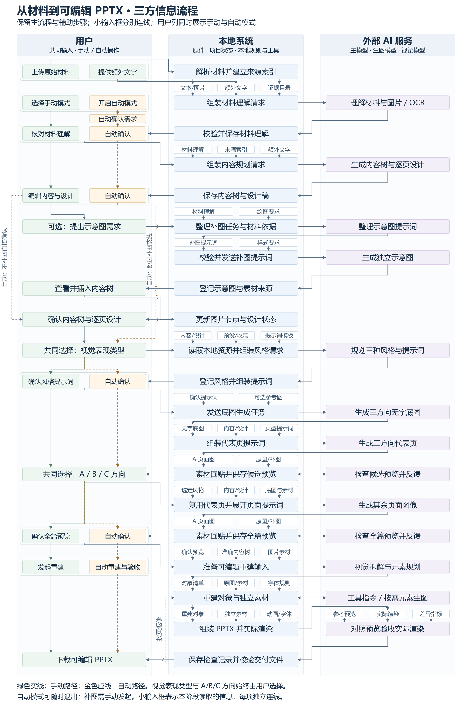
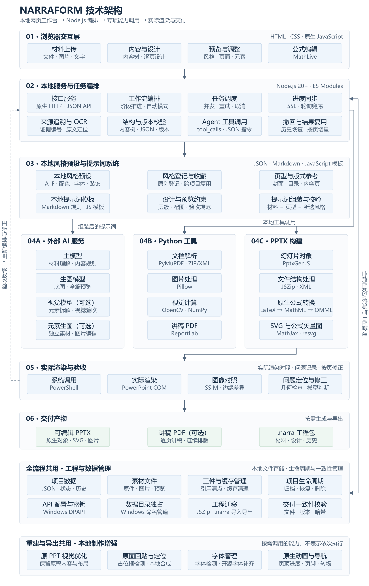

# NARRAFORM

把原始材料转成有来源索引、可编辑的 PPTX。通过本地网页完成材料理解、内容规划、视觉预览和元素重建，自行配置模型 API。

## 启动

**环境要求**：Node.js 20+、Python 3.11+。完整的 PPTX 渲染与对照需要 Windows 和已安装的 Microsoft PowerPoint。

```powershell
git clone https://github.com/fang628/NARRAFORM-pptx-workflow.git NARRAFORM
cd NARRAFORM
.\start.cmd
```

启动脚本会补齐缺少的依赖并运行服务，在浏览器访问 [本地工作台](http://127.0.0.1:4357/)。更新代码后重新运行脚本即可补充新增依赖。也可手动安装与启动：

```powershell
npm.cmd install
python -m venv .venv
.\.venv\Scripts\python.exe -m pip install "pip>=26.3,<27"
.\.venv\Scripts\python.exe -m pip install -r requirements.txt
npm.cmd start
```

自定义端口：`$env:PORT='4359'; npm.cmd start`。通过 `PPT_AGENT_PYTHON` 可指定 Python 路径。

Windows 下同一数据目录只允许一个服务实例，避免多个端口同时改写项目。需要独立运行时，同时设置不同的 `PPT_AGENT_DATA`；强制结束进程后独占访问由系统自动释放。

## API 配置

在网页右上角填写 Base URL、模型名和 API Key，支持自动保存与连接测试。全部项目共用一套配置，修改或清除会对全部项目生效，新建、切换及导入项目均可直接复用。

| 通道 | 用途 |
| --- | --- |
| 主模型 | 材料理解、内容规划、设计稿及工具修改；兼任视觉任务时需支持图片输入 |
| 生图模型 | 底图、视觉方案、全篇预览；需支持图片生成和参考图编辑 |
| 高性能视觉模型（选填） | 元素拆解与视觉验收，留空沿用主模型 |
| 元素生图模型（选填） | 补充图片及纯色底素材生成，留空沿用生图模型 |

文字接口采用 Chat Completions 兼容协议；生图采用 Images API 的 `generations` / `edits`，不支持异步轮询协议。整页图片要求 16:9，优先 1920×1080。

Windows 下密钥使用当前用户 DPAPI 加密保存，重启自动恢复；升级时自动迁移最近保存的可解密项目配置；其他平台仅存于内存。API 调用及连接测试可能消耗供应商额度。

## 使用流程

1. **需求与材料**：上传文件、文件夹或粘贴文字，理解材料并提取图片。目标页数可留空，由 AI 建议；支持单页生成，最多 30 页，单文件上限 500 MB。可编辑页顶进度章节、选择页脚页码、裁切组合图，保留原件。
2. **逐页内容**：AI 先规划全篇页序、材料和配图，再逐页生成多层内容树和单页设计稿。长材料按页面选择的证据块发送，保留相邻条件、完整表格和公式结构；完整原文和证据索引仍保存在本地。上传材料下的补充文字作为制作要求贯穿规划、正文精简和单页设计，不作为同级材料或证据。设计稿只保留会影响后续排版、图文位置、承载、视觉关系和局部风格的说明。可编辑文字、图片说明、表格、公式与来源索引，拖动排序或调整层级，也可生成补充图片。仅修改文案时可直接同步设计稿；点击“保存并确认内容与设计”进入视觉方案。
3. **视觉方案**：选择简约平面或写实／立体表现，确认三种风格及提示词，生成底图与代表页预览。可先处理已完成设计的页面；原创风格支持收藏并跨项目复用。
4. **全篇预览**：选定方向后复用有效代表页，补齐其余页面。在对应底图上构建信息，本地将材料原图贴回占位框，查看完整成品后进入交付。
5. **导出交付**：拆解并重建元素，组装 PPTX，通过实际 PowerPoint 渲染逐页对照。可按页修改、补拆和撤回，下载最近构建的 PPTX；讲稿 PDF 按需生成，按页编号分点、连续排版。

支持自动模式，自动完成材料处理、内容确认、预览与交付流程，表现类型和视觉方向由用户选择。可随时退出；关闭网页后后台任务继续运行，服务重启后自动模式暂停。

任务采用动态有界并发：文字与生图按接口分池，共享项目、供应商账户和服务总额度；根据响应耗时与限流调整并发，遇到 429 遵守 `Retry-After`。默认自动分配，不设单项目固定配额；也可在 API 设置中选择单项目上限 1–6。账户最多并发 6、服务总量最多 12，跨项目公平分配，交互请求优先；运行中可调整，不中断在途请求。相同在途请求合并，完成后的主动重生成仍会重新调用模型。

五步按可执行依赖并发调度：材料按文档与页并发解析；先规划全篇页序和配图，再逐页生成内容与设计；底图、预览生成与检查交叠执行；重建时并发处理独立元素，复用成功素材与未变页面。成功内容逐页保存，失败后补齐缺页；实际请求始终受并发上限与供应商限流约束，PowerPoint 渲染保持串行。

材料中的表格优先直接读取文件内的表头与单元格；扫描件读取为结构化数据，不裁成配图、不登记表格图片，供内容树按需选用为可编辑表格。

论文配图结合文件内图片边界、图注编号与局部图像分析定位完整范围；组合图通过子图说明、标签、空白分隔与连通结构互证后拆分，单图不按局部视觉框随意拆开。扫描件和直接图片的 AI 分离使用同样的边界检查。自动裁片先保留完整内容、收掉多余留白，再本地补一圈同背景色薄边。完整原图保留，子图从原件裁切并记录来源；无法可靠拆分时保留整图并提示。

整页生成后即可检查该页；05 的单页检查完成后可先修正，其他页继续处理。交互请求优先调度，同批尚未开始的匹配单页任务可并入流水线，其余任务按列表顺序执行。PowerPoint 渲染保持串行，本地图像处理与主要 SVG 渲染使用有界进程／工作线程。进度通过 SSE 增量推送，断线后回退轮询；关键结果立即保存，频繁进度合并写入。

PPT/PDF 在 01 逐页分析布局与叙述逻辑，只提取内容图片。PPTX 图片直接读取内嵌原件，组合图与原生图表按对象独立导出；页面截图仅供分析。上传 PPTX 后，在补充说明写明“只优化视觉风格、不重做”，02 将沿用原稿页序、文字、图文位置与关系，后续只优化视觉并重建。

## 流程与架构

05 默认采用分阶段重建：先完成元素与形状识别，再拟合文字、填充及描边并归并有依据的参数。独立 SVG 按实际渲染偏差进行有限参考拟合，变差时回退；材料原图使用登记原件。完整流程图见 [05 整体流程](docs/step05-overall-flow.md)。

05 统一使用一条生产管线，旧工程中的重建模式字段和旧环境开关不再切换拟合器。首次审计完成补全与几何，随后按填充、描边、文字取色、归并执行；局部修正按变更依赖复用相同阶段，并保护显式样式和修改范围。工具操作通过、初始审计状态及实际视觉验收分别记录，工具成功不会清除未解决问题。

文本承载不强制原生，实现方式以最初登记为准：SVG 承载保留完整 SVG，原生承载继续原生拟合，文字保持独立可编辑；frameKind、内容归属和简单轮廓不会触发 SVG 转原生。描边只从可见的边界亮脊取样，依据覆盖率、偏移稳定性和拟合残差计算置信度；缺失证据不使用默认高置信度。透明描边基于实际下层底色反推颜色，S6 使用同一套亮脊证据，保留的审计线宽不冒充独立测量。

S2 补全先定位文字和素材，再排除已有前景，避免错位文字残留被误补成底板；S3 复用定位证据，用更新后的前景遮罩拟合形状和线路径。重定位根据每个对象自身轮廓或行首字形匹配批准预览，预览及对象参数指纹变化才重测；不再由父框位移平移正文，也不按父框自动收窄文字框。程序导航、表格专用布局和已批准材料图片位置保留各自来源；局部修改只提交授权对象，歧义匹配保持原位置。重定位证据进入后续组件排版，避免再次被父框锚点覆盖。同形四角在没有可靠观测时共享初始默认参数，默认来源与实测来源分别记录，默认置信度为零；真实观测冲突或显式保护仍保持独立。

生产审计与离线模拟共用关系准备入口，重复承载的同形候选独立于颜色，保留各自坐标及尺寸；角部共享使用独立角部证据，不能借用直边支持度。S3 使用实际字形与素材透明遮罩保留可见边界，S5b 只提交颜色，不测量或改写字重、斜体。独立 SVG 可比较参考支持的简单单色内部轮廓候选及共享色值候选，保留外框与孔洞；复杂纹理不转成碎片路径，最终仍按实际 PowerPoint 渲染择优或回退。

独立 SVG 拟合先用少量规则轮廓候选比较六边形朝向、对称外形和弧线曲率；明确的环形对象可比较椭圆环候选，再细调位置、线宽及效果。同心轮廓共享几何变换，保留内部细节与真实环层，不把多层光效统一概括为单条线。候选评分缓存及单尺度局部渲染减少重复计算，不增加模型调用。

SVG 几何拟合将外轮廓、内部图案和所属装饰放在同一坐标系中一起构造、一起提交并整体变换；参考候选同时还原外框与内部孔洞，不能只替换内部通用图标。评分同时记录内部重合度、边界、孔洞与连通关系，不能仅靠外框改善取得高分。首次审计随现有请求附局部放大图，不额外增加模型轮次。SVG 弧形装饰补全保留实际曲率、断口与不同环层，同心环合成一个SVG，亮芯和柔光共享曲线。

SVG 局部搜索中的平移和缩放作用于完整主体，不再分别移动各层或扰动单个顶点。候选生成时保留现有视口内的完整绘图，页面位置调整通过对象坐标完成，避免为提高局部分数而裁掉斜切端点；长六边形标签不套用规则徽章的四分之一宽度斜切候选。

<details>
<summary>三方信息流程：用户、本地系统与外部 AI 服务（点击展开）</summary>



</details>

<details>
<summary>技术架构：网页交互、任务编排、重建与交付（点击展开）</summary>



</details>

## 编辑与重建

- **材料追溯**：逐项建立来源索引，点击可定位原文；保留文档中的文字格式、表格和公式信息。扫描页及图片型公式的格式恢复效果取决于识别结果。
- **原生公式**：按页面内容需要选用材料中的公式，在独立节点中可视化编辑或修改 Markdown/LaTeX；仅增删或修改公式时，保存会自动同步有效设计稿。预览提示词保留实际公式，05 重建为可编辑的 Office 原生公式，支持分数、上下标、根式和矩阵。专用 LaTeX 宏需改为通用写法。
- **图片修改**：图生图小修改发送调整意见；文生图重绘发送确认后的最终提示词。支持框选定位、跨方向参考结构，以及图片和提示词的撤回。
- **可编辑重建**：文字、普通线条和简单色块用 PPT 原生对象；复杂形状、平面图标用 SVG；复杂画面与现实图标先分析目标前景颜色，自动选择色差较大的纯色底，再附参考图生成素材并本地去底，失败后用预览和登记无字底图本地分离；不请求透明背景模式。小标题与正文、目录编号与标题分别独立。缺失的开源字体按需自动补齐，书法字可框选后沿用这条兼容路径，成功后替换对应原生文字；分离失败保留现有页面。
- **单页调整**：在意见框输入 `@` 后点击元素即可指定修改；遗漏元素可框选补拆。支持单页重试、工具修正与撤回，未修改页面复用已有对象、渲染图和检查记录。
- **局部原生组合**：05 分开保存对象身份与测量参数，对编号与圆形、图注与图片、表格整体、公式与公式框登记局部组件，按载体关系和实测字形校准位置后生成 PowerPoint 原生组合。子文字、公式和图片仍可独立编辑或取消组合；跨对象叠放无法安全保留时，保留逻辑组件并记录未组合原因。
- **统一线路径**：直线、折线和曲线使用单个linePath开放M/L/Q/C路径，同一拟合器联合求解控制点、线宽及两端标记；折线直接导出PowerPoint原生自定义路径，不分段、不建立组合或接缝搭接。端点圆和箭头仅为路径端点属性；粗箭头、异形箭头和光条走SVG。旧直线专用拟合、独立端点测量、折线组合实现已移除。

实线以登记位置选中参考图中的连通对象，再从完整骨架的真实两端追踪，搜索窗口不足时按对象尺度扩展，不把初始登记的局部端点当作最终边界。中间圆点记录于 `linePath.nodes`，端点圆的实测直径记录于 `linePath.terminals.begin/end`，与线身共用一个原生自定义图形，保留实测直径、颜色及渐变；控制点或共享斜度变化时圆点跟随所在路径位置。端点尺寸显式保护时保留指定的标记尺寸。存在真实分支或闭环时不以最短路径冒充完整折线。拟合按每段的可见覆盖与位置误差计算证据，不能只凭主干的高支持率接受缺失段；遮挡单独记载，不向归并提供独立的可靠观测。

线路径的每个直线段可用 `linePath.segmentGroups:{"2":"edge-group"}` 与图形斜边共享斜度，数字是路径命令序号，仅允许 L 段；未声明时按相近方向和局部边界保守归组。S3 在对象拟合后按独立置信度加权归并，并验证目标段及相邻段的参考边界；位置、宽高、颜色、线宽不因共享斜度一起归并。S5 在填充完成后的真实下层复合上，沿最终路径测量虚实、颜色、单侧/双侧透明度渐隐和端点。遮挡、缺口、变细、底色不匹配不能被伪装成渐隐，显式样式保护、单段退组及局部提交范围分别生效。

骨架转为折线时，在约2.5–3.5逻辑像素的误差内优先使用更少线段，忽略细小抖动；同一转角附近的短碎折线用两侧主线的交点合成一个转角。真实长跨度、主要转向、端点与圆点保留，简化在斜度归并之前完成；已登记的曲线和受保护的段不重写为简化折线。

属于线身的圆点只能位于端点或真实折点。按圆点直径和线宽确定8–18逻辑像素的就近范围，附近圆点移到对应锚点；同锚点圆点合并并保留较大实测直径，端点圆转为端点信息。不将共线顶点当折点，不为保留圆点新增转角；距离过远的线身圆点不输出。独立项目符号保持独立。登记、几何拟合、斜度归并及输出共用这项口径。

补全按已有路径的实际 L 段排除重复亮线，不再使用包围框对角线。SVG光条、粗线转换与原生预览共用线身、圆点及端点绘制，保留曲线、虚线、实测直径与渐变；独立SVG的端点直接写入几何，不依赖素材工具不支持的marker。对象遮罩缺失时用同一开放路径模型生成降级蒙版；表格取证按实际线身像素排除，网格吸附同时更新M/L命令，避免旧方向或折点残留。

接近水平的 L 段（绝对斜角不超过 3°）在同一次路径求解中吸附为完全水平，共享拐点连续，曲线不被展平，显式斜度与位置锁定仍保留。完整框体的定位证据按轮廓弧长等距采样，避免像素碎转角比长边获得更多权重。SVG 参考拟合不再按清单顺序仅取前四个，所有符合范围且存在差异的SVG均可进入页级时间预算。
- **视觉对照**：结合轮廓拟合、文字尺寸实测、SSIM 与边缘差异定位问题，最多自动工具修正两轮，之后可手动按页继续修正。未通过检查的页面保留问题标记，仍可下载已构建的 PPTX；文件缺失或版本、哈希不一致时禁止下载。
- **原生动画**：页顶进度条可选箭形或气泡横列，共享 4–6 个章节，位置和长度沿用一张参考预览，可偏置；渐变与描边按实际效果选用。跨页原生文字主标题的位置、字号与样式平滑过渡，书法图片标题仅淡入淡出；可选右下角页脚页码，05采用紧贴右下角的小型原生直角梯形，字体加粗、配色按底图统一，封面和目录隐藏，换页平滑切换；换章节时指示块滑动、章节字号与字重平滑变化，其余内容及底图淡入淡出。在 PowerPoint 放映中播放。

PPT 风格依据随项目提供的 [风格与规范库](workflow-library/) 和 [设计规范](DESIGN_STANDARDS.md)，也支持登记原创风格。

## 数据管理

项目、材料、生成图片、撤回历史和加密 API 配置存于 `data/`，支持归档、恢复和删除。

在 **工件与存储 → 工程迁移** 中导出 `.narra` 工程包，包含材料、内容树、设计稿、预览、重建结果及撤回历史，排除无引用缓存和 API 密钥。在另一台已安装本工具及运行依赖的机器上导入，会恢复为新项目，复用目标机器的通用 API 配置后可继续编辑和重建。工程包上限 1 GB，单个解压文件上限 500 MB、总计 4 GB。

“工件与存储”按引用关系区分当前结果、撤回历史和无引用缓存，只清理缓存。内容更新后可沿用原布局与图片、同步新文案；02 误改导致 05 结果隐藏时，可在符合恢复条件的情况下撤回误改。

测试目录、本地项目、缓存、导出文件、依赖及密钥均已加入 Git 忽略规则。`tests/` 仅作为本地验证目录，运行生成的 `work/`、`exports/` 和报告也不会进入版本库。更新后端需重启服务；前端更新刷新页面即可。

本项目为单用户本地版，仅监听 `127.0.0.1`。使用 AI 功能时，相关材料会发送至配置的模型供应商。Agent 忠实呈现材料，来源索引用于追溯材料。

## 后记

<details>
<summary>开发初衷</summary>

脑力劳动本身是抽象的，它必须借助某种表现形式，才能被看见、被理解、被评价。但劳动与劳动表现并不总是一致：有人精于汇报而疏于产出，有人长于做事却拙于呈现。前者让表现脱离劳动，后者让劳动隐没于沉默。两者都不利于社会主义按劳分配，因为分配若缺乏可靠、可比、可追溯的劳动表现，就容易依赖印象、口才和形式。

PPT 正是一种典型：它普遍、费力，且常常与真正的汇报内容关系不大。我做这个工具不是为了制造更华丽的包装，而是希望根据原始材料自动生成美观、直观、忠实于原材料的 PPT。让内容决定形式，让材料自己说话，让每一页都能追溯到它的来源。

如果这个工具只能做到一件事，我希望是：把“做 PPT”从表演劳动还原为表达劳动。当抽象脑力劳动能够被自动汇总为具象、可核验的表现，按劳分配便至少多了一条有据可循的线索。它不能解决分配的全部问题，但可以减少形式对内容的遮蔽，降低表达对产出的扭曲。

愿这个工具让不善汇报者不再被埋没，让擅长包装者不能轻易掩盖真实贡献；让创造者少花时间在排版表演上，多花时间在真正的创造上。愿每一份真实劳动，都能被看见，能被公正地对待。社会主义的按劳分配必然实现，共产主义必然实现！

</details>
